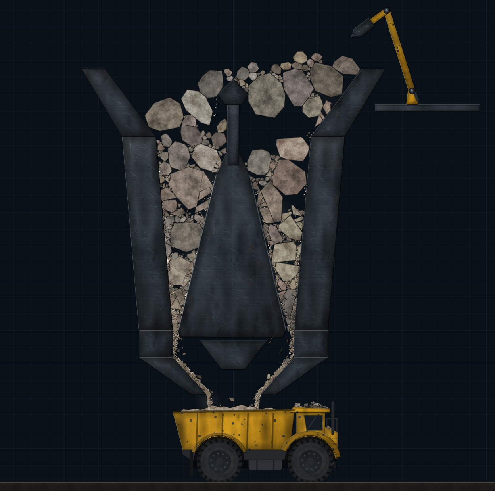
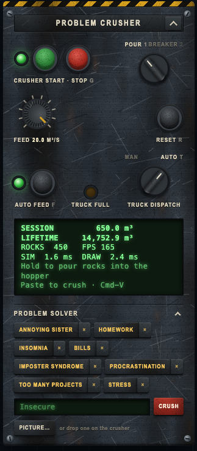
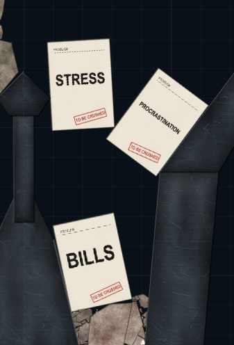
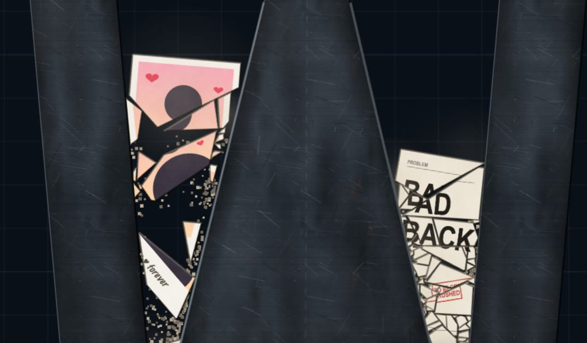

# Problem Crusher

An x-ray side view of a 26 m tall gyratory cone crusher, running on real-time 2D physics in the browser. Pour rocks into the hopper and watch the gyrating mantle squeeze them until they crack, chip, grind into flowing sand and drop into a dump truck that hauls it all away.

It also turns out to be a self-help tool. Type in a problem, and the machine prints it on a sheet of paper and crushes it into smaller problems.

**Live at [crusher.codeflex.no](https://crusher.codeflex.no)**

Therapy. You're crushing it.

<p align="center"></p>

## What you can do

- **Pour rocks.** Hold the mouse button (or your finger) over the hopper to pour a stream of mixed rock. The Feed dial sets how fast it flows, from 1 to 20 m³/s.
- **Run the crusher.** The green and red buttons start and stop the mantle. Stop it to let the hopper fill up, then start it and watch the chamber come alive.
- **Hammer with the hydraulic breaker.** Turn the tool selector to Breaker to take over the boom (see [Steering the breaker](#steering-the-breaker)).
- **Crush your problems.** Open the Problem Solver section of the panel, type a problem and press Crush.
- **Crush pictures.** Drop an image onto the crusher, pick one with Picture…, or paste one from your clipboard.
- **Haul it away.** Crushed material collects in the truck under the outlet. Send full trucks off by hand, or let them leave on their own.
- **Watch the numbers go up.** The green LCD counts how much rock you have crushed this session and over your lifetime.

<p align="center"></p>

## Things that are easy to miss

### Paste anything straight into the crusher
Press **Cmd-V** on a Mac or **Ctrl-V** elsewhere anywhere on the page, without clicking into a text field first:
- A copied **image** drops in as a picture slab.
- Copied **text** is printed on a problem sheet and dropped in. Long text is trimmed to 80 characters, so a whole email still fits on one sheet.

Pasting into the problem field works like a normal text field.

<p align="center"></p>

### Drag and drop pictures
Drag an image file from your desktop onto the machine. It drops in above the spot where you let go, so you can aim for one side of the hopper. Pictures keep their aspect ratio, and their long side is scaled to 3 m. They crack and shatter along with everything else.

<p align="center"></p>
<p align="center"><em>Your ex, breaking into smaller problems. (A generic silhouette, no real exes were harmed.)</em></p>

### Saved problems
Every problem you type gets its own key in the Problem Solver, so you can crush "Mondays" again with a single click. The × next to a key forgets it. Up to 12 problems are kept, newest first.

If you can't think of a problem, the field cycles through suggestions. Pressing Crush with an empty field crushes whichever suggestion is showing.

### Automatic modes
Two things can run on their own. Each has a switch on the panel and a keyboard shortcut.

- **Auto feed (F):** keeps the hopper topped up to the rim. It measures how high the pile is across the hopper and pours over the lowest spot. If one side is jammed by a bridge of rocks, it keeps filling the open side. It stops when the hopper is full and starts again when the level drops.
- **Truck dispatch (T):** the MAN/AUTO knob. In AUTO a full truck drives off by itself and the next one rolls in from the left. In MAN the Truck Full lamp lights up, and you click or tap the truck to send it off.

Turn auto feed off when you work with the breaker, or new rocks will bury the boom.

### Steering the breaker
Switch the tool selector to Breaker, or press **2**.
- **Move the pointer** and the boom follows it, reaching into the hopper and the upper chamber.
- **Hold the button** to start the hammer.

Every blow sends a shock through the rock it hits and on into the rocks touching it, so you can break up a jammed bridge from above. Switch back to Pour (**1**) and the boom parks itself.

### The control panel moves
- **Drag** the panel by its nameplate or the hazard stripe to put it where you like. Its position is remembered.
- **Collapse** it with the chevron in the corner.
- On a phone held upright, the panel docks to the bottom of the screen. On short landscape screens, it docks to the left. Tap the nameplate to fold it away and get more room for the machine.

### Reset and memory
Reset (**R**) empties the machine and starts the session counter again. Your lifetime total, your saved problems and all panel settings are stored in the browser and come back on your next visit.

## Keyboard shortcuts

| Key | Action |
|---|---|
| G | Start or stop the crusher |
| 1 / 2 | Pour tool / Breaker tool |
| F | Auto feed on or off |
| T | Truck dispatch MAN / AUTO |
| R | Reset the machine |
| Cmd-V / Ctrl-V | Crush whatever is on the clipboard |

The shortcuts are ignored while you are typing in the problem field.

## What makes the physics fun

Nothing in the machine is scripted. Every crack comes from the forces in the chamber.
- **Rocks break where the load is.** Thick rocks are stronger than thin slabs. Damage builds up with every squeeze until a rock cracks along the line of the force.
- **Bridges don't last forever.** Rocks can wedge together and arch over the chamber, as they do in real crushers. The machine's constant vibration slowly wears the edges and shakes loose the small binding pieces until the bridge gives way.
- **Fines flow like sand.** The smallest pieces turn into flowing sand that pours off the mantle, through the outlet and into the truck bed.
- **The trucks are heavy.** They accelerate slowly, brake ahead of the dock, sag as the load grows and puff a little diesel smoke when they pull away. Each one holds 100 m³.
- **The mantle keeps time.** It gyrates twice a second. If the frame rate drops, the physics catches up so the crusher keeps its real-world pace.

## Running it locally

```sh
npm install
npm run dev
```

Then open the URL Vite prints. `npm run build` type-checks the project and writes a production build to `dist/`.

The project uses TypeScript, Vite and [Rapier2D](https://rapier.rs) for the physics, and draws everything on plain canvases with no UI framework. Every push to `main` deploys to GitHub Pages through `.github/workflows/deploy.yml`.

The `scripts/` folder holds two headless debugging helpers that run the simulation in Node: `probe.ts` and `snapshot.ts`, which writes SVG snapshots.
